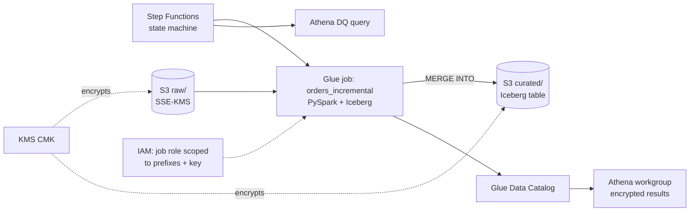

# aws-glue-iceberg-terraform

[](https://github.com/navyaajs-web/aws-glue-iceberg-terraform/actions/workflows/ci.yml)


Terraform for a small AWS data lake. It covers:
- S3 raw and curated buckets.
- A Glue Data Catalog.
- An incremental Glue PySpark job that writes Apache Iceberg tables.
- An Athena workgroup.
- A customer-managed KMS key.
- Least-privilege IAM.
- A Step Functions state machine that runs the job and then a data check.

CI validates everything **without AWS credentials**, and the Glue job's transform logic is unit-tested locally.

## Problem
Teams often hand-build Glue jobs and buckets in the console. That leads to three problems:
- Encryption is inconsistent.
- IAM roles are too broad.
- Jobs reprocess everything on every run.

This repository shows the same stack as reviewed, testable code.

## Architecture


## Run it in three commands
```bash
make init      # terraform init for every module and example (no backend, no credentials)
make check     # fmt -check, validate, tflint, checkov, terraform test (mock providers)
make unit      # pytest for the Glue transform logic with local PySpark
```
**Optional deploy:** `examples/dev` with your own AWS account. See `docs/deploy.md`. A deploy will incur small AWS charges.

## What is inside
| Path | What it does |
|---|---|
| `modules/lake_storage/` | Buckets, KMS key, bucket policies (TLS-only, deny puts that are not SSE-KMS with the lake key), lifecycle rules |
| `modules/glue_catalog/` | Database + Iceberg table definitions |
| `modules/glue_job/` | Job, script upload, incremental settings (table watermark + lookback; job bookmarks explicitly disabled), scoped IAM role |
| `modules/orchestration/` | Step Functions definition, retry and catch, SNS alert on failure |
| `modules/athena/` | Workgroup with enforced encrypted results |
| `examples/dev/` | Wires every module into one deployable dev stack |
| `glue/orders_incremental.py` | Reads new raw partitions and `MERGE INTO` the Iceberg table on the business key |
| `tests/*.tftest.hcl` | `terraform test` with `mock_provider "aws"`, asserting encryption, IAM scope and naming |
| `tests/unit/` | pytest for the transform functions |

## What this proves
- I can deliver an AWS Glue + Iceberg platform as modular Terraform with security defaults (KMS, least privilege, TLS-only).
- I can make the Glue job incremental.
- I can keep it all checked in CI.

## Limitations
- `terraform test` with mock providers proves configuration logic, not live AWS behaviour.
- The Glue job's transforms are tested with local PySpark 4.0, not the Glue runtime image (Glue 5.0 runs Spark 3.5). The Iceberg runtime is not loaded in the tests, so the `MERGE INTO` statement is checked as SQL text and not executed.
- Checkov is a hard CI gate, with five skips. Each skip and its reason is listed in `.checkov.yaml`.

## About the author
Built by Navya Sindhu, Senior Data Engineer. [LinkedIn](https://www.linkedin.com/in/navyaajs/). This is a personal project. It contains no employer or client infrastructure, account IDs or code.
